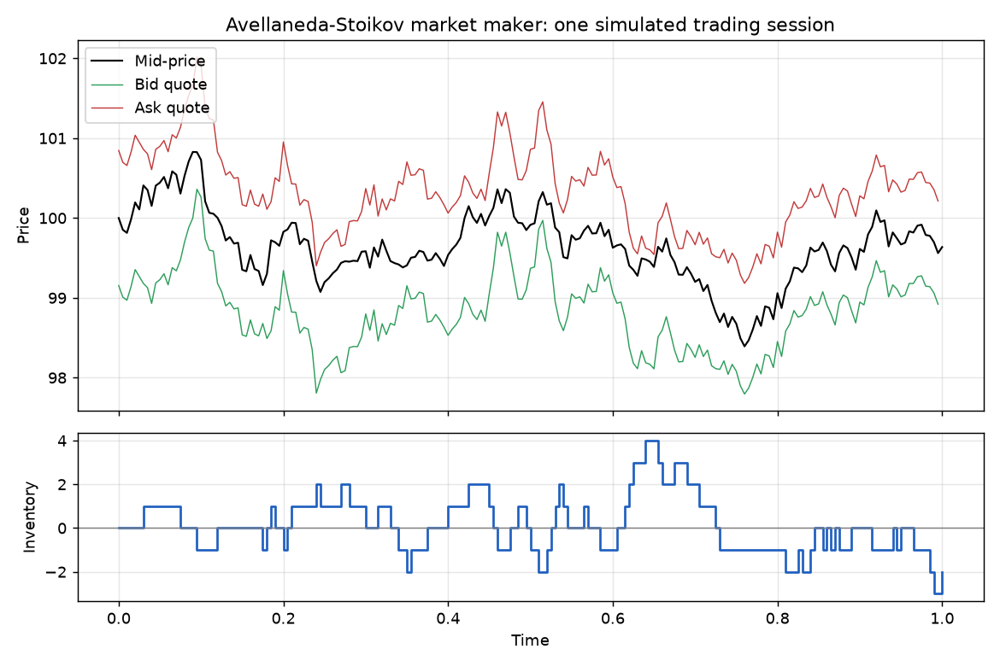
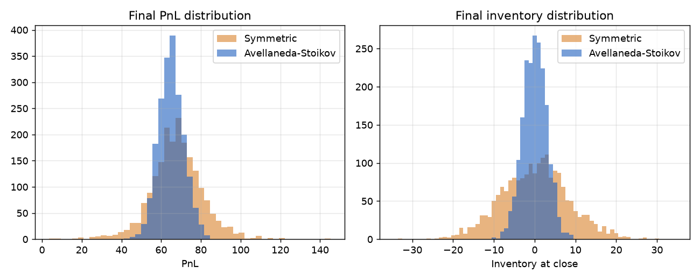
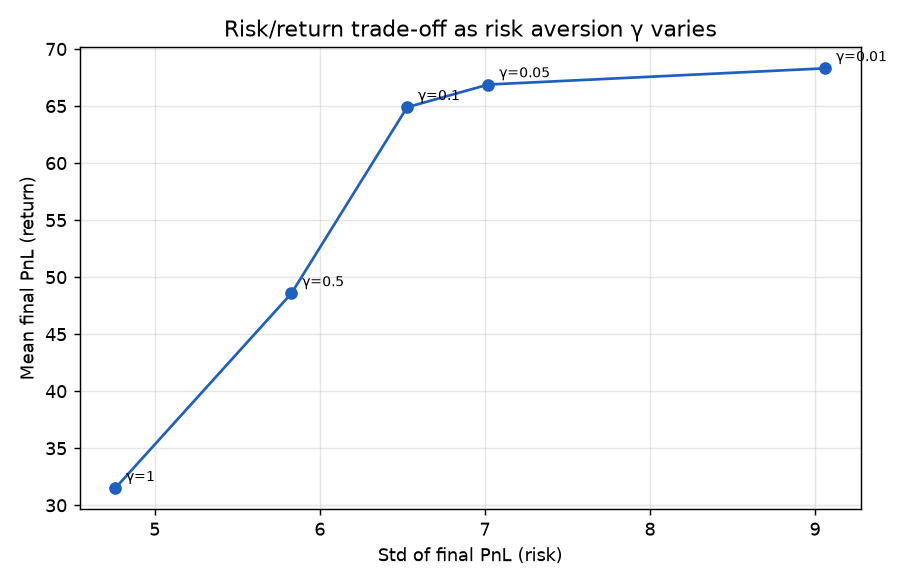

# Market-Making Simulator: Inventory Risk & the Avellaneda–Stoikov Model

A Monte Carlo simulator of a **market maker** who continuously quotes bid and ask prices, earns the spread, and has to manage the risk of the inventory they accumulate.

It implements the optimal quoting strategy from **Avellaneda & Stoikov (2008), *High-frequency trading in a limit order book*** and compares it with a naive benchmark over 2,000 simulated trading sessions.



## The problem

A market maker profits by buying at the bid and selling at the ask. But fills are random: after a run of sells hit your bid, you are **long inventory** and exposed to price moves. The question is how to set quotes that capture spread **without** accumulating dangerous positions.

## The model

**Mid-price.** Arithmetic Brownian motion: $dS_t = \sigma\, dW_t$.

**Order flow.** A quote at distance $\delta$ from the mid gets filled with Poisson intensity
$$\lambda(\delta) = A e^{-k\delta},$$
so tighter quotes fill more often but earn less per trade.

**Optimal quotes (Avellaneda–Stoikov).** A market maker with exponential utility and risk aversion $\gamma$ quotes around a *reservation price* instead of the mid:

$$r(s, q, t) = s - q\,\gamma\,\sigma^2\,(T - t)$$

$$\delta^a + \delta^b = \gamma\,\sigma^2\,(T - t) + \frac{2}{\gamma}\ln\!\left(1 + \frac{\gamma}{k}\right)$$

**Intuition:** when long ($q > 0$) the reservation price drops below the mid, so both quotes shift down. The ask becomes more attractive (you sell more) and the bid less attractive (you buy less), which pulls inventory back toward zero.

**Benchmark.** The *Symmetric* strategy uses the **same spread** but always centers it on the mid-price. Any difference in results therefore isolates the value of inventory management.

## Results

2,000 Monte Carlo paths, $S_0 = 100,\ \sigma = 2,\ T = 1,\ dt = 0.005,\ \gamma = 0.1,\ k = 1.5,\ A = 140$.

| Strategy | Mean PnL | Std PnL | Sharpe | Mean abs. final inventory |
|---|---|---|---|---|
| Avellaneda-Stoikov | 65.04 | 6.31 | **10.31** | **2.33** |
| Symmetric | 67.81 | 13.02 | 5.21 | 6.57 |

The inventory-aware strategy gives up ~4% of expected PnL but **cuts PnL volatility in half** and ends the day with ~3x less inventory, roughly **doubling the Sharpe ratio**. These numbers closely reproduce those reported in the original paper.



### Risk aversion as a dial

Sweeping $\gamma$ traces a risk/return frontier: higher risk aversion means wider spreads and stronger inventory skew, which lowers both return and risk.



## Project structure

```
marketmaker/
  params.py       # market & strategy parameters
  strategies.py   # Avellaneda-Stoikov and symmetric benchmark
  simulator.py    # vectorised Monte Carlo engine (all paths simulated in parallel with NumPy)
tests/            # unit tests (quote skew, PnL accounting, reproducibility, risk reduction)
run.py            # runs the experiment and generates every figure and table
```

## Run it

```bash
pip install -r requirements.txt
python run.py      # prints results, saves figures/
pytest             # 6 tests
```

## Possible extensions

- Inventory limits and the Guéant–Lehalle–Fernandez-Tapia closed-form solution
- Estimating $A$ and $k$ from real limit-order-book data
- Adverse selection: informed order flow that is correlated with future price moves
- Discrete tick sizes and queue position

## Reference

M. Avellaneda and S. Stoikov (2008). *High-frequency trading in a limit order book.* Quantitative Finance, 8(3), 217–224.
